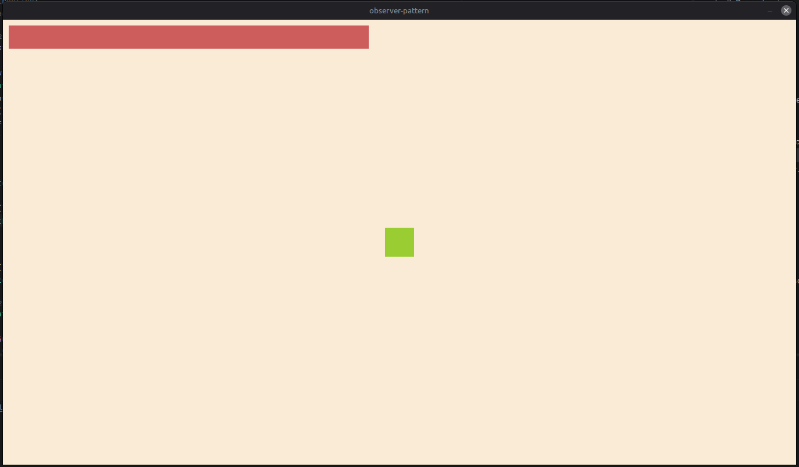

# observer-pattern
my study of the observer pattern for games, using monogame for rendering and the main loop. 

this pattern involves interactions between different elements without tight coupling, I applied this in the example project by creating the Player.cs and UiManager.cs source files.

there are two main components: the **subject** (the element being observed) and the **observers** (elements that perform an action when notified of specific events). while c# provides and *event* keyword that can be used with this pattern, I decided after reading up on the subject to try implementing the concept without it.

I created an IObserver interface, which includes an OnNotify method triggered upon receiving an event, and an abstract Subject class. the latter maintains a list of observers and provides methods to add or remove them, it also includes a Notify method that iterates through the list of observers, calling their respective OnNotify methods.

in this way, the UI can receive relevant information from the player such as their current health without any tight coupling between the two entities!! it can also be used in achievement systems (like Robert Nystrom example) or other systems that should not require coupling (such as an AudioManager)

# references
https://en.wikipedia.org/wiki/Observer_pattern
https://gameprogrammingpatterns.com/observer.html

# project


# controls
<sub>dont have controls!</sub>

# how to run
```bash
git clone https://github.com/katsudev22/observer-pattern.git
cd observer-pattern
dotnet run
```
<sub>*(make sure you have requirements for run monogame and dotnet!!)*</sub>
